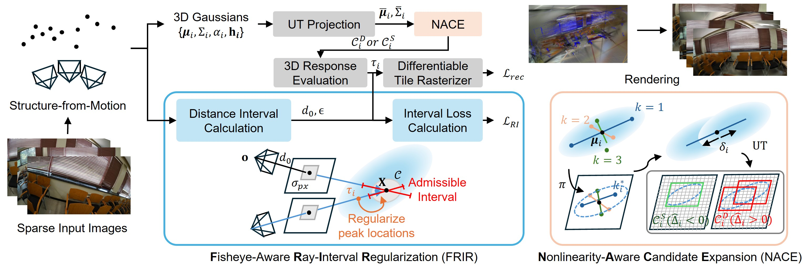
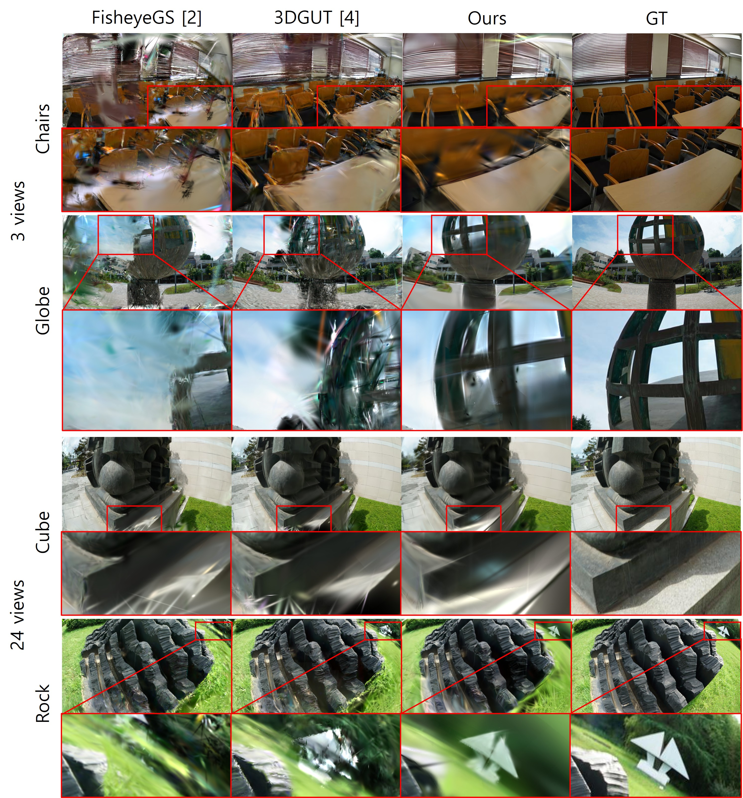

# GASF-GS

Sparse-view fisheye 3D Gaussian Splatting with **Nonlinearity-Aware Candidate
Expansion (NACE)** and **Fisheye-Aware Ray-Interval Regularization (FRIR)**.
This repository contains the full model's training, native CUDA rendering,
training-only anchor construction, and held-out evaluation code.



NACE adapts tile candidates to nonlinear fisheye footprints, while FRIR
regularizes individual 3D response distances using triangulated anchors.

## Installation

Linux, an NVIDIA GPU, Python 3.10, a CUDA toolkit with `nvcc`, and a compatible
C++ compiler are required. The code was checked with PyTorch 2.7.1,
torchvision 0.22.1, CUDA 11.8, GCC 11, and an RTX 6000 Ada GPU.

```bash
git clone https://github.com/Jmyeong/GASF-GS.git
cd GASF-GS

conda create -n gasf-gs python=3.10 -y
conda activate gasf-gs
python -m pip install torch==2.7.1 torchvision==0.22.1 \
    --index-url https://download.pytorch.org/whl/cu118
python -m pip install -r requirements.txt

# Adjust these paths to your CUDA toolkit and compiler.
export CUDA_HOME=/usr/local/cuda-11.8
export CC=gcc-11
export CXX=g++-11
export MAX_JOBS=4
python -m pip install --no-build-isolation --no-deps ./third_party/fisheye_rasterizer
python -m pip install --no-build-isolation --no-deps ./third_party/simple_knn
python -m pip install --no-build-isolation --no-deps ./third_party/ray_trace
```

Install COLMAP separately if preparing ScanNet++ from downloaded DSLR data.
COLMAP is not invoked during training on already prepared scenes. LPIPS loads
pretrained VGG weights on its first use; network access or cached weights are
needed for that evaluation.

## Data

Training consumes prepared native fisheye scenes, with fixed camera poses and
`OPENCV_FISHEYE` intrinsics. Each scene must have the following layout:

```text
3dgs/
  GASF-GS/                     # this repository
  dataset/
    FisheyeNeRF/
      chairs_3/                # also chairs_12/, chairs_24/, ...
        images/
        sparse/0/
          cameras.bin
          images.bin
          points3D.bin         # points3D.ply is also supported
        train.txt
        test.txt
      existing_baselines/      # prepared comparison-model image domains
    ScanNet++/
      raw/data/<scene>/dslr/   # downloaded native data
      sparse/<scene>_<views>/  # training-only COLMAP reconstruction
      benchmark/
        ours/<scene>_<views>/  # default GASF-GS training inputs
          images/
          masks/               # <image stem>.png, when provided
          sparse/0/...
          train.txt
          test.txt
        shared/                # images and common evaluation masks
```

The six scripts default to `../dataset/FisheyeNeRF` and
`../dataset/ScanNet++/benchmark/ours`, relative to the repository location.
`--data-root` overrides those defaults. Local compatibility links in `data/`
point to the same shared inputs and are excluded from Git.

COLMAP text models are also supported. Split files list complete image names,
one per line, matching `images.bin` or `images.txt`. Training and test lists
must be nonempty and disjoint. Exactly 3, 12, or 24 training images are required
for the corresponding script. Keep initialization points reconstructed from
the selected training views. Test observations must not be used to reconstruct
the training point cloud or build FRIR anchors.

FisheyeNeRF scripts discover `chairs`, `cube`, `flowers`, `globe`, `heart`, and
`rock`. ScanNet++ scripts discover all prepared scene IDs. Use `--scenes` to
select a subset and `--data-root` to read an existing data directory without
copying it.

### Preparing ScanNet++

Download authorized scene data using the dataset's official tools. This
repository does not contain a downloader, access token, or dataset images.
For each scene, the input must include `dslr/resized_images/`,
`dslr/colmap/cameras.txt`, `dslr/colmap/images.txt`, and
`dslr/train_test_lists.json`; `dslr/resized_anon_masks/` is needed when the
official split indicates masks.

```bash
python prepare_scannetpp.py \
    --raw-root ../dataset/ScanNet++/raw/data \
    --output-root ../dataset/ScanNet++/sparse \
    --scenes 21d970d8de 0d2ee665be
```

The preparer uses the provided fisheye images, poses, and intrinsics. It creates
nested 3/12/24-view subsets from the official training pool, matches features
on CPU, and triangulates each subset with fixed calibration. Selection uses
pose coverage and verified matches in a 24-view training pool. Test images
are appended with their supplied poses and no point observations. Input
images and masks are linked; the downloaded source data is not modified.
To train directly on newly prepared native inputs, supply
`--data-root ../dataset/ScanNet++/sparse` to a ScanNet++ training script.

## Training

Run from this repository. Each script trains **NACE + FRIR for 30,000 iterations**,
with seed 0, then saves test-view renderings and PSNR, SSIM, and LPIPS.

| Dataset | 3 views | 12 views | 24 views |
| --- | --- | --- | --- |
| FisheyeNeRF | `script/train_FisheyeNeRF_3.sh` | `script/train_FisheyeNeRF_12.sh` | `script/train_FisheyeNeRF_24.sh` |
| ScanNet++ | `script/train_ScanNetpp_3.sh` | `script/train_ScanNetpp_12.sh` | `script/train_ScanNetpp_24.sh` |

```bash
bash script/train_FisheyeNeRF_3.sh --gpus 0 1
bash script/train_FisheyeNeRF_12.sh --gpus 0 1
bash script/train_FisheyeNeRF_24.sh --gpus 0 1

bash script/train_ScanNetpp_3.sh --gpus 0 1
bash script/train_ScanNetpp_12.sh --gpus 0 1
bash script/train_ScanNetpp_24.sh --gpus 0 1
```

GPU indices are physical CUDA indices. Jobs are distributed dynamically, with
one scene per selected GPU. The runner only launches and stops its own jobs.
Specify the GPUs appropriate for your machine.

```bash
# Existing data, a scene subset, and a separate results directory
bash script/train_ScanNetpp_3.sh \
    --data-root /path/to/prepared/scannetpp \
    --scenes 21d970d8de 0d2ee665be \
    --output-root output --gpus 0 1

# Inspect commands without starting training
bash script/train_FisheyeNeRF_3.sh --gpus 0 --dry-run
```

All six scripts accept the same options. `--help` lists them; `PYTHON` can
select a Python interpreter. Anchors are constructed from training images
automatically. To reuse validated anchors, set `--anchors-root` to a directory
containing `<scene>_<views>/anchors.json`.

For an individual scene or a checkpoint resume:

```bash
python train.py --dataset FisheyeNeRF --views 3 \
    --source ../dataset/FisheyeNeRF/chairs_3 \
    --output output/FisheyeNeRF/chairs_3/seed_0

# Same source, output, and settings as the interrupted run
python train.py --dataset FisheyeNeRF --views 3 \
    --source ../dataset/FisheyeNeRF/chairs_3 \
    --output output/FisheyeNeRF/chairs_3/seed_0 \
    --resume output/FisheyeNeRF/chairs_3/seed_0/checkpoint.pth
```

Matching completed runs are skipped. Partial runs require an explicit resume
or a new output directory. Checkpoints are saved every 5,000 iterations and
at the final iteration. `--skip-lpips` omits LPIPS while retaining test renders,
PSNR, and SSIM.

## Outputs

```text
output/<dataset>/<scene>_<views>/
  seed_0.log
  seed_0/
    config.json              # resolved settings and input path
    anchors.json             # fixed FRIR anchors and input hashes
    progress.json            # latest training status
    checkpoint.pth           # resumable model, optimizers, and RNG states
    training.json            # timing and FRIR gradient-check status
    completed.json           # successful completion marker
    metrics.json             # per-view metrics and scene means
    point_cloud/iteration_30000/
      point_cloud.ply
      nace_gate.pth
    test/iteration_30000/
      renders/<view>.png
      gt/<view>.png
      mask/<view>.png         # ScanNet++ evaluation masks
```

FisheyeNeRF evaluation uses the full native image and VGG LPIPS v0.1.
ScanNet++ uses the common calibrated field-of-view intersection, masked
PSNR/SSIM, and masked spatial VGG LPIPS v0.1. For the latter, predictions
are quantized to saved uint8 values and pixels outside the evaluation mask
are filled with RGB 0.5 before feature extraction. Existing prepared benchmark
masks are used when available; otherwise the same geometric intersection is
computed from calibration.

## Method and implementation

- **Rendering:** UT candidate projection, original 3D ray responses, and
  per-pixel response-distance sorting with K = 16.
- **NACE:** projection-curvature axis selection, moment-preserving virtual
  components with displacement 0.55 times the selected principal standard
  deviation, and a detached seven-feature MLP gate. A sampled coverage teacher
  trains the gate with BCE. Components only generate candidates; the original
  Gaussian is composited once per tile. The teacher is disabled at inference.
- **FRIR:** training-only COLMAP tracks and mutually matched RootSIFT anchors,
  fixed-calibration uncertainty propagation, and contribution-weighted
  interval penalties on individual anisotropic response peaks. Only positions,
  scales, rotations, and opacities receive direct FRIR gradients.

This release preserves the evaluated **learned-gate implementation**. NACE
axis probes use **one principal standard deviation**, not three. Both Single
and Split UT regions are constructed before gate selection. The gate avoids
coverage-teacher evaluation at inference; no rendering speedup is claimed.

Defaults live in `gasf/config.py`: gate BCE weight 0.01, FRIR weight 0.5,
mass penalty weight 0.01, pseudo-Huber scale 0.1, pixel localization standard
deviation 1 pixel, and minimum relative interval half-width 0.01. FRIR runs
every 8 steps on up to 64 rays, starting at step 200 and ramping to full weight
at step 1000. Densification statistics use photometric gradients only.

```text
gasf/
  config.py, data.py, model.py      # settings, scene input, Gaussian state
  render.py, trainer.py            # forward rendering and optimization
  nace/                           # projection, gate, coverage teacher
  frir/                           # triangulation, anchors, trace, interval loss
  evaluation.py                   # test renders and quantitative metrics
third_party/                      # required CUDA sources and GLM headers
script/                           # the six dataset/view training entry points
tests/                            # geometry and loss invariants
```

## Qualitative examples



FisheyeNeRF examples comparing FisheyeGS, 3DGUT, GASF-GS (Ours), and ground
truth. Chairs and Globe use 3 training views; Cube and Rock use 24 training
views. Red boxes highlight the enlarged regions.

## Validation

All three native extensions were rebuilt from these sources. Original and
refactored code were compared using existing FisheyeNeRF and ScanNet++ full
model checkpoints: rendered pixels, teacher outputs, and FRIR loss values
matched; geometry gradient comparisons passed. Fresh 601-step training on
each dataset checks FRIR activation, densification, checkpoint/PLY saving,
and held-out rendering. This is a compatibility check, not a new 30K benchmark.

```bash
python -m unittest discover -s tests -v
```

## Attribution and license

See [LICENSE](LICENSE) and [THIRD_PARTY_NOTICES.md](THIRD_PARTY_NOTICES.md).
The inherited Gaussian Splatting license permits noncommercial research and
evaluation use. Dataset files, pretrained weights, build products, experiment
outputs, and local reference audits are excluded from version control.
